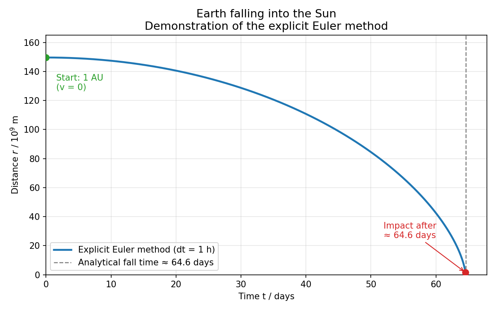

# TU Delft FEM Course

Worked examples from the one-week intensive course **"Finite Element Modeling of Vibrating Elastic Structures"** at **TU Delft**, taken as part of the **ATHENS programme**, a European network that offers short, intensive courses hosted by partner technical universities. Many thanks to **Professor Domenico Lahaye** for the course and for the clear and inspiring introduction to the finite element method.

The goal of this repository is to make the mathematical principles behind the finite element method tangible. Each example is a small, self-contained implementation that goes from the governing equations to a working numerical solution and a plot.

## Repository Structure

```
tudelft_fem_course/
├── euler_method/   # Time integration and time evolution
└── fem/            # Time-independent FEM for elastic structures
    ├── 1d/         # 1D examples (Julia and Python)
    └── 2d/         # 2D examples (Julia, Gmsh meshing)
```

### `euler_method/`



Everything related to the Euler method and the time evolution of dynamic systems: discretizing in time and stepping a solution forward.

### `fem/`

Time-independent (static) finite element analysis of elastic structures:

#### `1d/`

1D finite elements with linear shape functions, in both Julia and Python, including a convergence study over increasing mesh resolution.

#### `2d/`

2D finite elements on triangular meshes generated with Gmsh, including assembly of the stiffness matrix and load vector, Dirichlet boundary conditions, and visualization of the solution.

Each subfolder has its own short README with details on how to run the code.

## Requirements

- **Julia** with the packages `Plots` and `Gmsh`
- **Python** with `numpy` and `matplotlib`

## Notes

These examples are meant for learning and illustration rather than performance. The implementations favor clarity, with explicit loops and dense matrices, over efficiency.

## Use of AI

AI tools were used to generate the plots and to write the README files. The mathematical considerations and the Python implementations are my own work.