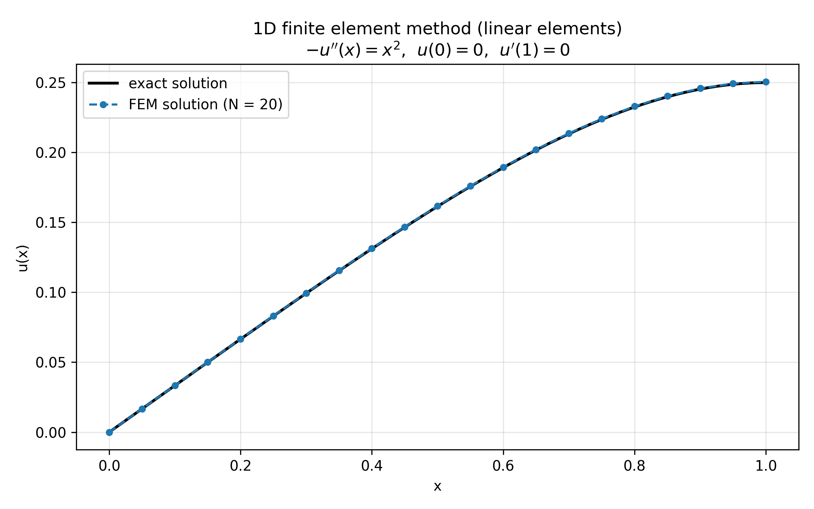

# 1D FEM (Julia & Python)

Solves -u'' = f with f(x) = x² on [0,1] using linear (P1) elements, for N = 2, 4, ..., 20 elements to show convergence.

- **Boundary:** Dirichlet u(0) = 0, natural (zero-flux) at x = 1
- **Output:** one plot with all solutions, saved as a PNG

## Files

| File | Description | Output |
|---|---|---|
| `fem_1d.jl` | Julia version | `fem_1d_julia.png` |
| `fem_py.py` | Python version (NumPy) | `fem_py_1d.png` |

## Run

    julia fem_1d.jl
    python fem_py.py

Requires `Plots` (Julia) and `numpy`, `matplotlib` (Python).