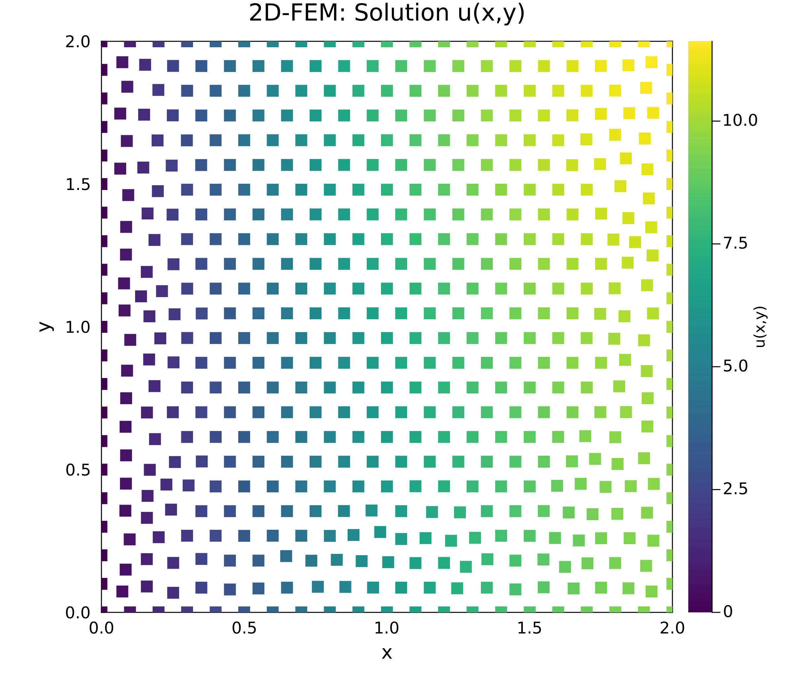

# 2D FEM in Julia

Solves the Poisson problem -Δu = f with f(x,y) = x³ + y³ on the square [0,2]² using linear (P1) triangular elements.

- **Mesh:** Gmsh, element size `lc = 0.1`
- **Boundary:** Dirichlet u = 0 on the left edge (x = 0), natural (zero-flux) on the other edges
- **Output:** `u_julia.png` (solution plotted over the nodes)

## Run

    using Pkg; Pkg.add(["Gmsh", "Plots"])
    julia script.jl